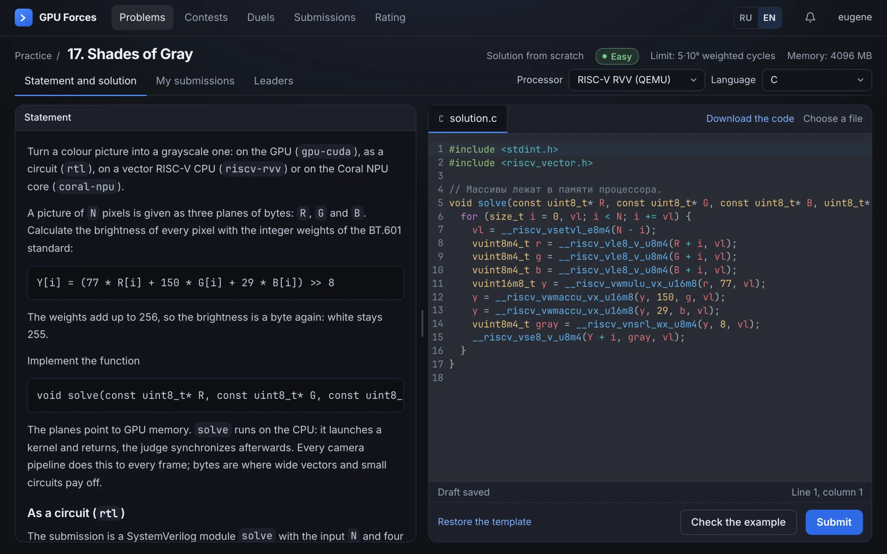
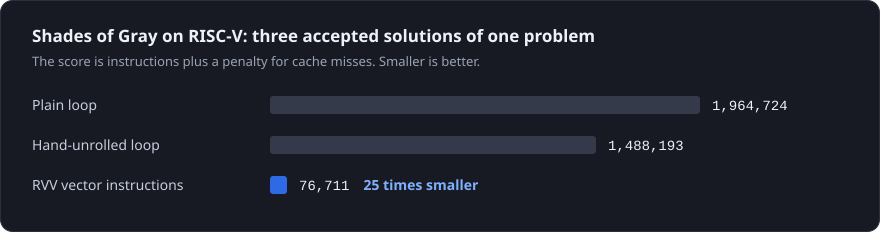
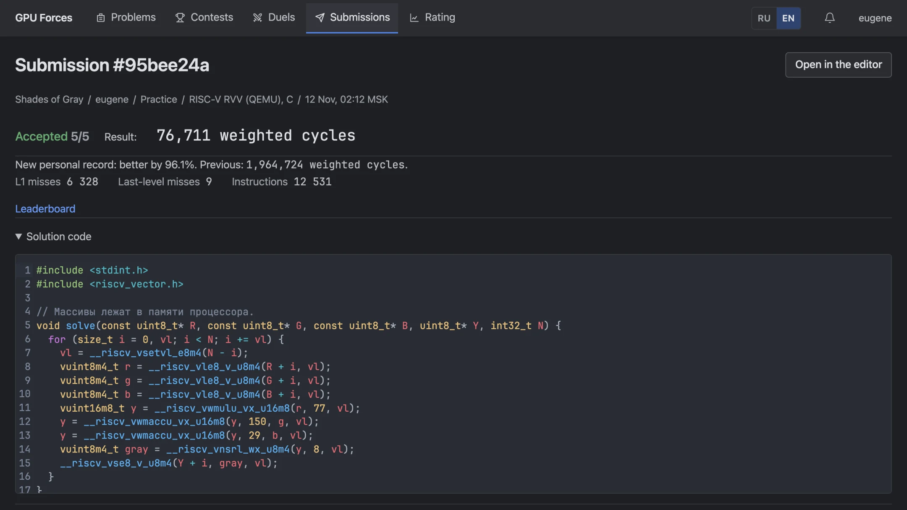
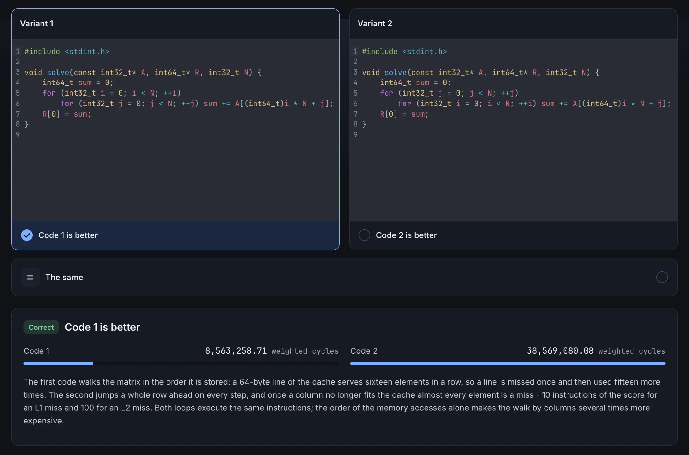
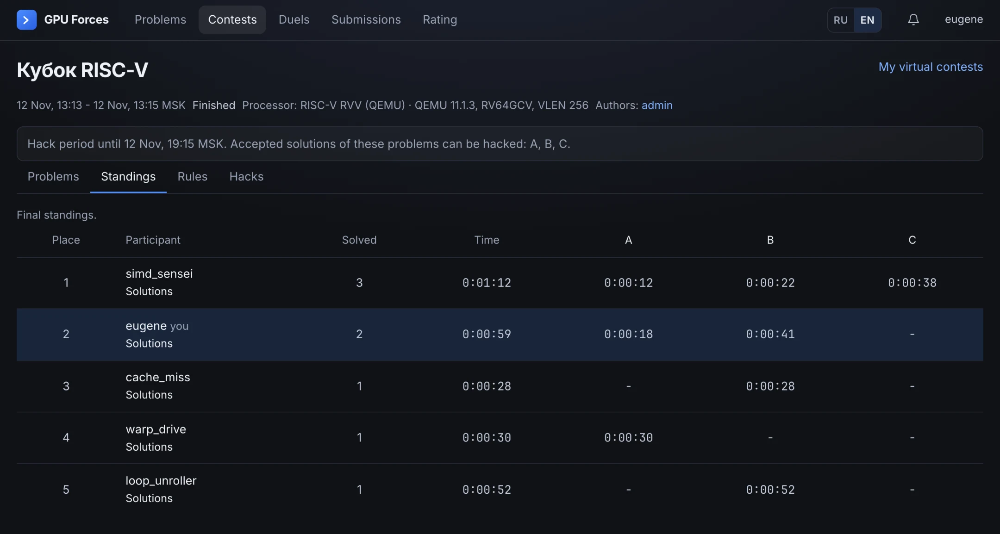
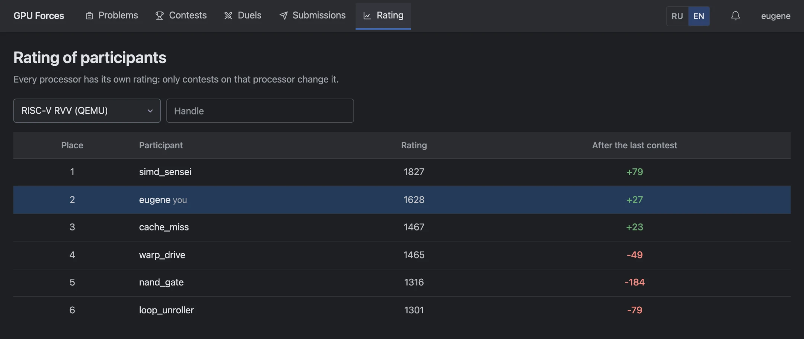
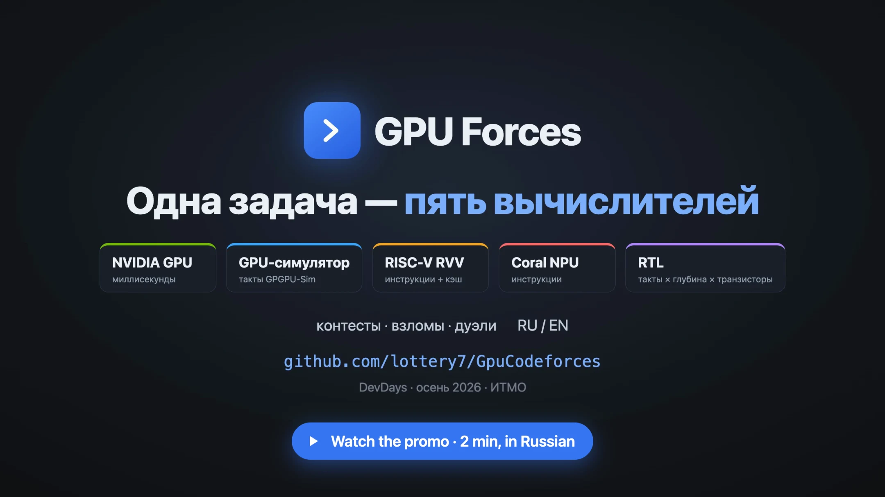

<div align="center">


# GPU Forces

**Competitive programming where a correct answer is not enough: the solution has to be fast on a given processor.**

[Promo](https://github.com/lottery7/GpuCodeforces/releases/latest/download/gpu-forces-promo.mp4) ·
[Slides](https://docs.google.com/presentation/d/1wK260FY0vNzkz17bJX9PXNFOtqUYCWwU7iATTw0A3wU) ·
[Problem bank](https://github.com/lottery7/GpuCodeforcesProblems) ·
[Quick start](#quick-start) ·
[Architecture](docs/architecture.md) ·
[Русский](README.md)

[](https://github.com/lottery7/GpuCodeforces/actions/workflows/backend.yml)
[](https://github.com/lottery7/GpuCodeforces/actions/workflows/frontend.yml)
[](https://github.com/lottery7/GpuCodeforces/actions/workflows/judge.yml)

</div>



## One problem, five processors

The same problem is solved on different hardware, and every processor scores it in its own way:

| Processor | What a participant writes | Score, smaller is better |
|---|---|---|
| `gpu-cuda` | CUDA for a real NVIDIA GPU | milliseconds |
| `cuda-sim` | the same CUDA, run in GPGPU-Sim on a model of the Tesla V100 | simulated GPU cycles |
| `riscv-rvv` | C, C++ or assembly for a vector RISC-V CPU in QEMU | instructions plus a penalty for cache misses |
| `coral-npu` | C or C++ for the Coral NPU core in Renode: 8 KB of code, 32 KB of data | instructions |
| `rtl` | a SystemVerilog circuit, synthesized by Yosys and simulated by Verilator | cycles × logic depth × transistors |

An accepted solution is not yet the best one: the place on the leaderboard is decided by the score. Here are
three accepted solutions of one problem, and their scores differ 25 times:



The emulator versions are pinned, so everything except `gpu-cuda` runs without a GPU and gives the same score on
any machine.

## What the platform does

**A verdict with measurements.** The judge compiles the solution itself, runs it in an nsjail sandbox and
measures the score. The verdict shows what the score is made of and how much the personal record improved.



**Three problem formats.** Write a solution from scratch, speed up a supplied one, or guess which of two codes
is faster. The third format needs no code at all.



**Contests, hacks and duels.** A contest runs on one processor. After it the problems can be upsolved, the
contest can be taken virtually, and participants hack each other's solutions with their own tests. A duel is a
one-on-one match on a random or a chosen problem.



**A rating per processor.** A Codeforces-style rating is kept separately for every processor: only the contests
on that processor change it.



Also:

- **A bank of thirty-three problems** lives in a repository of its own,
  [lottery7/GpuCodeforcesProblems](https://github.com/lottery7/GpuCodeforcesProblems). A problem is a package in
  git, and the platform pulls the repository by itself. Every problem has a leaderboard per processor.
- **The interface and the problem statements are in Russian and English**, switched in the header.

## Promo and slides

[](https://github.com/lottery7/GpuCodeforces/releases/latest/download/gpu-forces-promo.mp4)

Two minutes, in Russian: one problem on RISC-V and as a circuit, the guess format, a hack in a contest and the
rating. The file is in the [latest release](https://github.com/lottery7/GpuCodeforces/releases/latest).

[The slides of the project](https://docs.google.com/presentation/d/1wK260FY0vNzkz17bJX9PXNFOtqUYCWwU7iATTw0A3wU), in Russian, are the deck for the DevDays defense.

## Quick start

Docker is all you need.

```sh
git clone https://github.com/lottery7/GpuCodeforces.git
cd GpuCodeforces
JUDGE_PROCESSORS=rtl,riscv-rvv,coral-npu,cuda-sim docker compose --profile app --profile emu --profile cuda-sim up -d --wait --build
```

Open <http://localhost:3000>. The command starts the platform with the four emulated processors; no GPU is
needed. The first build takes a while: the images compile QEMU and GPGPU-Sim.

| Variant | Command |
|---|---|
| With an NVIDIA GPU (`gpu-cuda`): Linux or WSL2, driver 570+, `nvidia-container-toolkit` | `docker compose --profile app --profile gpu up -d --wait --build` |
| A look at the interface without real judging | `JUDGE_MODE=mock docker compose --profile app --profile mock up -d --wait --build` |

The user with the handle `admin` gets the administrator page `/admin`.

## Building from source

JDK 26, `python3` and a running Docker daemon are required: the PostgreSQL integration tests run on Docker. The
frontend needs Node 24 and pnpm.

```sh
./gradlew build
```

The command builds the backend and the judge services and runs all tests; Gradle does not have to be installed.
The frontend is built separately:

```sh
cd frontend && pnpm install --frozen-lockfile && pnpm build
```

Local development, running the services one by one and CI are described in
[docs/development.md](docs/development.md).

## Documentation

The backend and the judge are written in Kotlin with Spring Boot, the frontend in React and TypeScript; the data
is kept in PostgreSQL, and verdicts travel through RabbitMQ.

| Document | About |
|---|---|
| [docs/development.md](docs/development.md) | Building, local development, tests and CI |
| [docs/architecture.md](docs/architecture.md) | UML diagrams of the architecture (in Russian) |
| [docs/backend](docs/backend) | Submissions and judging, problem formats, contests and hacks, duels, the problem package (in Russian) |
| [judge/README.md](judge/README.md) | The testing system: processors, the sandbox, verdicts (in Russian) |
| [frontend/README.md](frontend/README.md) | The web interface |
| [docs/frontend/openapi.yaml](docs/frontend/openapi.yaml) | The API contract |

Made at the DevDays hackathon, autumn 2026, ITMO. The description of the project and the team are on the
[page of the project in the DevDays wiki](https://cs-uni.ru/index.php?title=%D0%9F%D0%BB%D0%B0%D1%82%D1%84%D0%BE%D1%80%D0%BC%D0%B0_%D0%B4%D0%BB%D1%8F_%D1%81%D0%BE%D1%80%D0%B5%D0%B2%D0%BD%D0%BE%D0%B2%D0%B0%D0%BD%D0%B8%D0%B9_%D0%BF%D0%BE_%D0%B0%D0%BB%D0%B3%D0%BE%D1%80%D0%B8%D1%82%D0%BC%D0%B0%D0%BC_%D0%BD%D0%B0_GPU) (in Russian).
