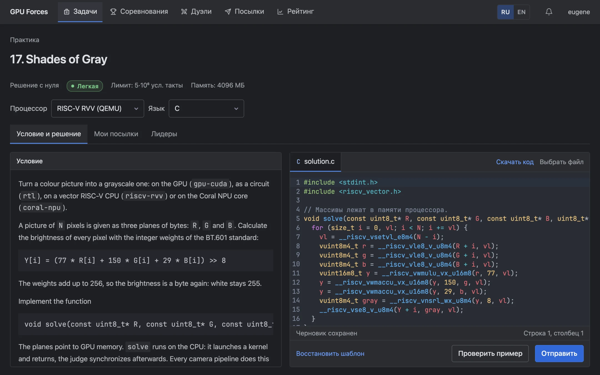
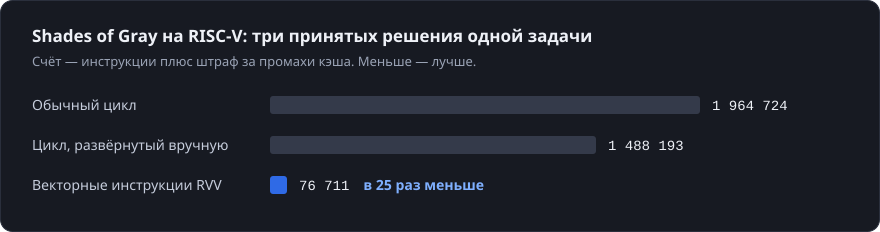
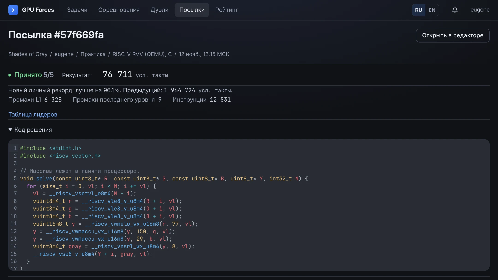
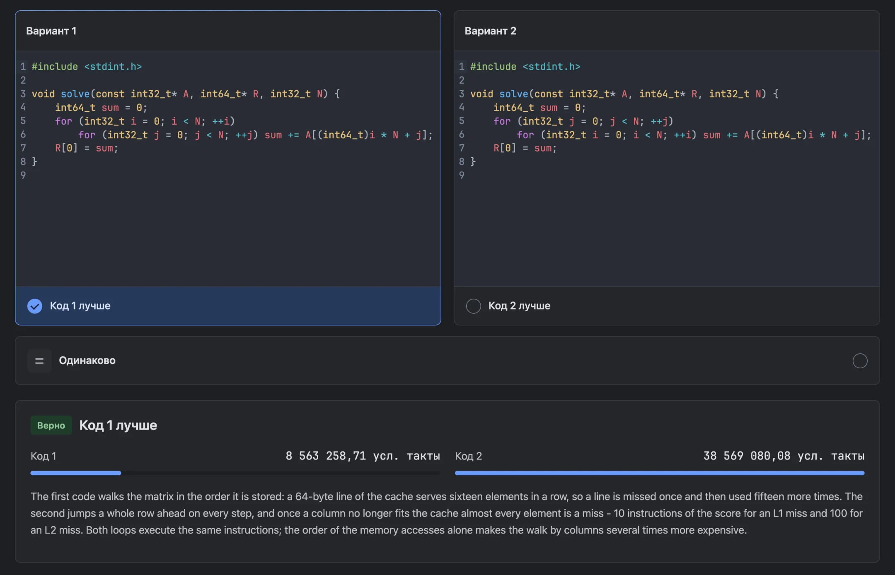
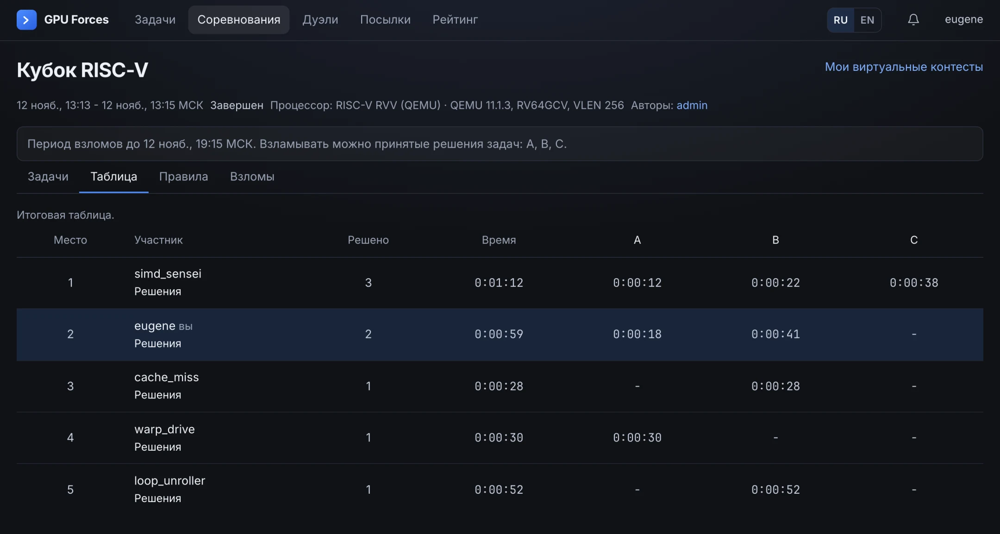
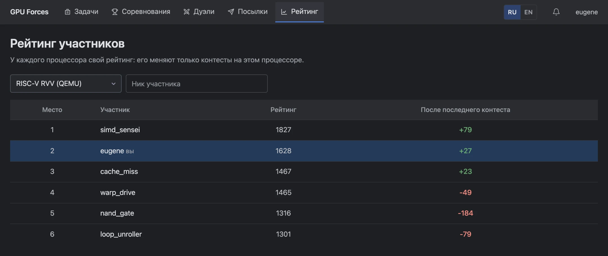
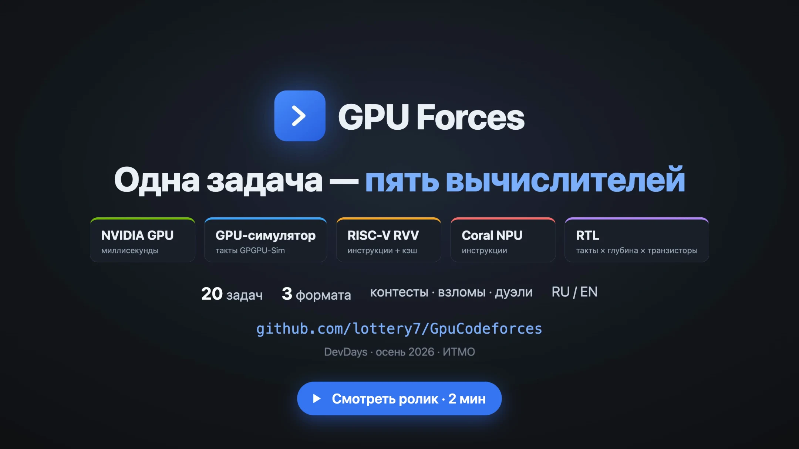

<div align="center">


# GPU Forces

**Соревнования по программированию, где мало решить задачу: её надо решить быстро на заданном процессоре.**

[Ролик](https://github.com/lottery7/GpuCodeforces/releases/latest/download/gpu-forces-promo.mp4) ·
[Банк задач](https://github.com/lottery7/GpuCodeforcesProblems) ·
[Быстрый старт](#быстрый-старт) ·
[Архитектура](docs/architecture.md) ·
[English](README.en.md)

[](https://github.com/lottery7/GpuCodeforces/actions/workflows/backend.yml)
[](https://github.com/lottery7/GpuCodeforces/actions/workflows/frontend.yml)
[](https://github.com/lottery7/GpuCodeforces/actions/workflows/judge.yml)

</div>



## Одна задача — пять процессоров

Одну и ту же задачу сдают на разном железе, и каждый процессор считает результат по-своему:

| Процессор | Что пишет участник | Счёт, меньше — лучше |
|---|---|---|
| `gpu-cuda` | CUDA для настоящей видеокарты NVIDIA | миллисекунды |
| `cuda-sim` | тот же CUDA в симуляторе GPGPU-Sim на модели Tesla V100 | такты симулируемой видеокарты |
| `riscv-rvv` | C, C++ или ассемблер для векторного RISC-V в QEMU | инструкции плюс штраф за промахи кэша |
| `coral-npu` | C или C++ для ядра Coral NPU в Renode: 8 КБ кода, 32 КБ данных | инструкции |
| `rtl` | схема на SystemVerilog: синтез в Yosys, симуляция в Verilator | такты × глубина логики × транзисторы |

Принятое решение ещё не лучшее: место в таблице лидеров определяет счёт. Вот три принятых решения одной
задачи, и счёт у них различается в 25 раз:



Версии эмуляторов закреплены, поэтому всё, кроме `gpu-cuda`, работает без видеокарты и даёт один и тот же счёт
на любой машине.

## Что умеет платформа

**Вердикт с измерениями.** Судья сам компилирует решение, запускает его в песочнице nsjail и считает счёт.
В вердикте видно, из чего счёт сложился и насколько улучшен личный рекорд.



**Три формата задач.** Написать решение с нуля, ускорить готовое или угадать, какой из двух кодов быстрее.
В третьем формате код писать не нужно.



**Контесты, взломы и дуэли.** Контест проходит на одном процессоре. После него задачи можно дорешивать,
пройти контест виртуально и взламывать чужие решения своими тестами. Дуэль — это состязание один на один
на случайной или выбранной задаче.



**Рейтинг на каждом процессоре.** Рейтинг в духе Codeforces считается отдельно для каждого процессора:
его меняют только контесты на этом процессоре.



Кроме того:

- **Банк из тридцати трёх задач** лежит в отдельном репозитории
  [lottery7/GpuCodeforcesProblems](https://github.com/lottery7/GpuCodeforcesProblems). Задача — это пакет в git,
  платформа забирает репозиторий сама. У задачи своя таблица лидеров на каждом процессоре.
- **Интерфейс и условия задач на русском и английском**, язык переключается в шапке.

## Ролик

[](https://github.com/lottery7/GpuCodeforces/releases/latest/download/gpu-forces-promo.mp4)

За две минуты: одна задача на RISC-V и в виде схемы, формат «угадай», взлом в контесте и рейтинг.
Файл лежит в [последнем релизе](https://github.com/lottery7/GpuCodeforces/releases/latest).

## Быстрый старт

Нужен только Docker.

```sh
git clone https://github.com/lottery7/GpuCodeforces.git
cd GpuCodeforces
JUDGE_PROCESSORS=rtl,riscv-rvv,coral-npu,cuda-sim docker compose --profile app --profile emu --profile cuda-sim up -d --wait --build
```

Откройте <http://localhost:3000>. Команда поднимает платформу с четырьмя эмулируемыми процессорами, видеокарта
не нужна. Первая сборка долгая: образы компилируют QEMU и GPGPU-Sim.

| Вариант | Команда |
|---|---|
| С видеокартой NVIDIA (`gpu-cuda`): Linux или WSL2, драйвер 570+, `nvidia-container-toolkit` | `docker compose --profile app --profile gpu up -d --wait --build` |
| Посмотреть интерфейс без настоящей проверки | `JUDGE_MODE=mock docker compose --profile app --profile mock up -d --wait --build` |

Пользователь с ником `admin` получает страницу администратора `/admin`. Сборка из исходников, локальная
разработка и тесты описаны в [docs/development.md](docs/development.md).

## Документация

Backend и судья написаны на Kotlin и Spring Boot, фронтенд — на React и TypeScript; данные хранит PostgreSQL,
вердикты идут через RabbitMQ.

| Документ | О чём |
|---|---|
| [docs/development.md](docs/development.md) | Сборка, локальная разработка, тесты и CI (на английском) |
| [docs/architecture.md](docs/architecture.md) | UML-диаграммы архитектуры |
| [docs/backend](docs/backend) | Посылки и проверка, форматы задач, контесты и взломы, дуэли, пакет задачи |
| [judge/README.md](judge/README.md) | Тестирующая система: процессоры, песочница, вердикты |
| [frontend/README.md](frontend/README.md) | Веб-интерфейс |
| [docs/frontend/openapi.yaml](docs/frontend/openapi.yaml) | Контракт API |

Проект сделан на хакатоне DevDays, осень 2026, ИТМО.
