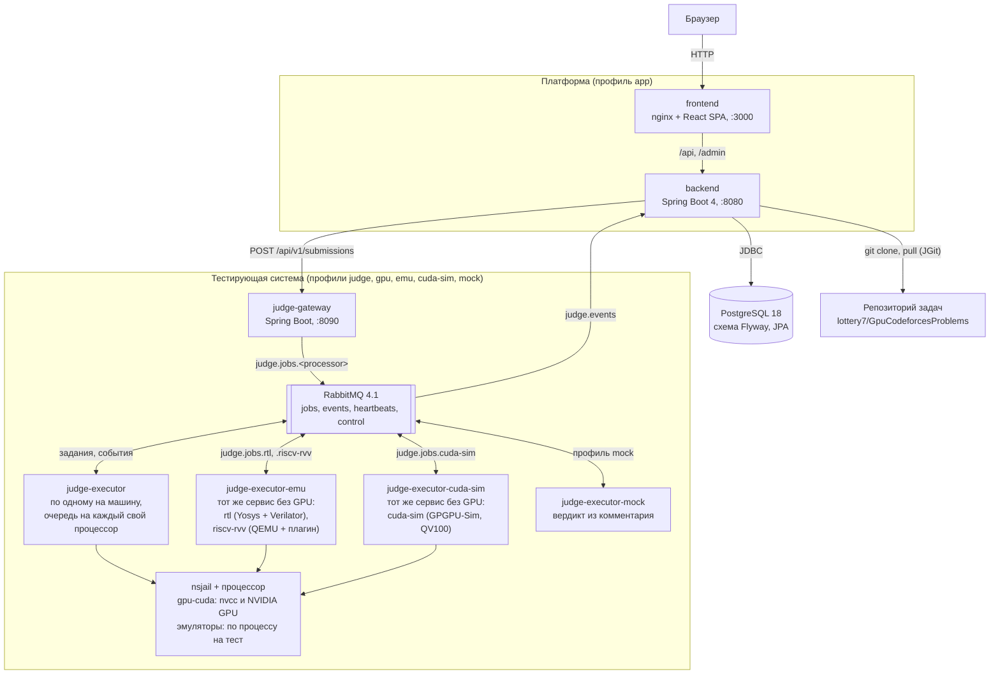
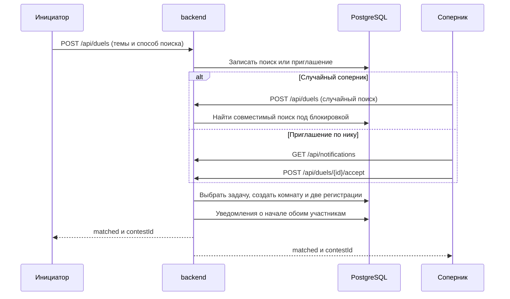
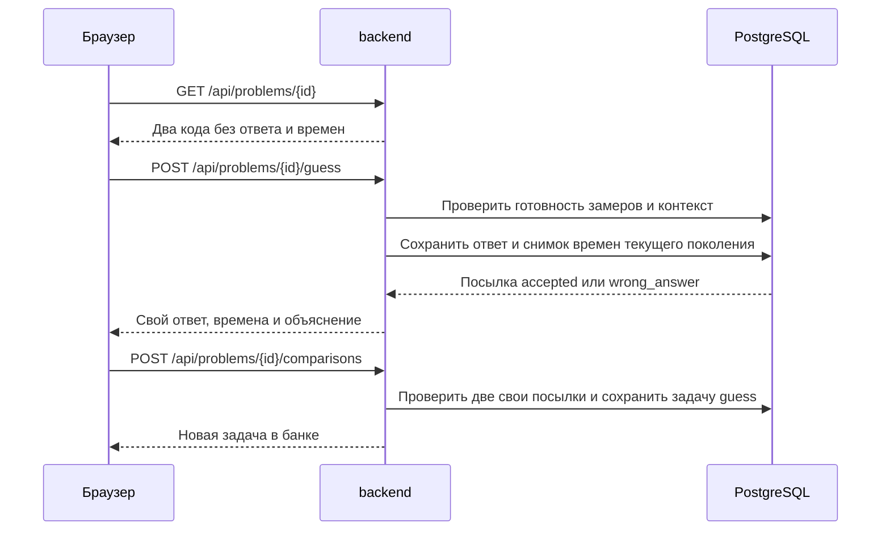
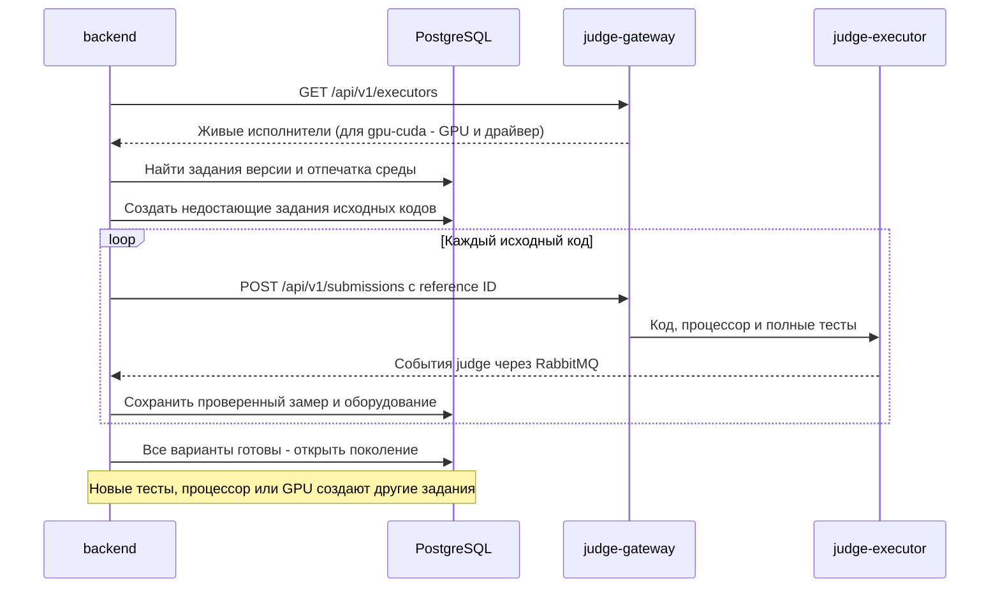
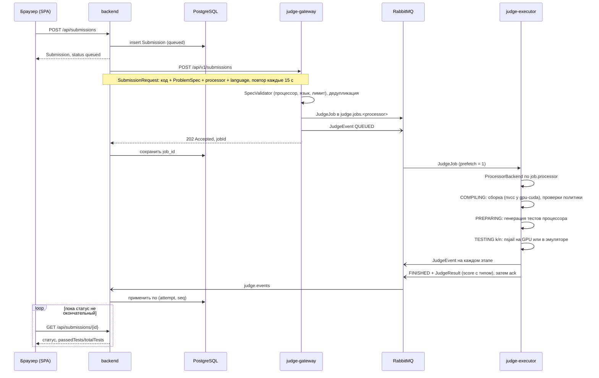
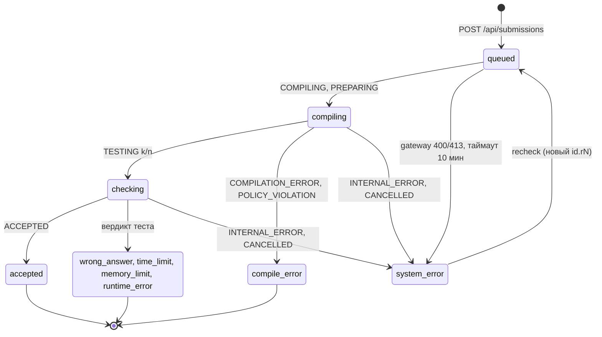
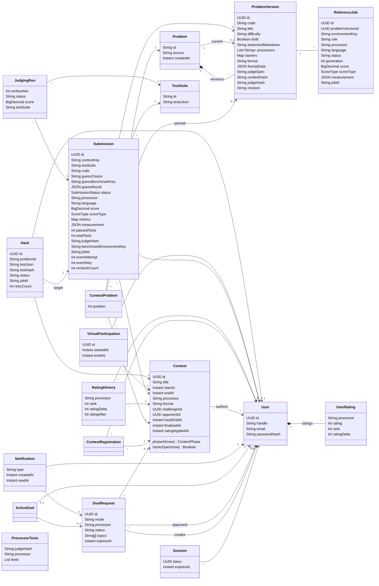
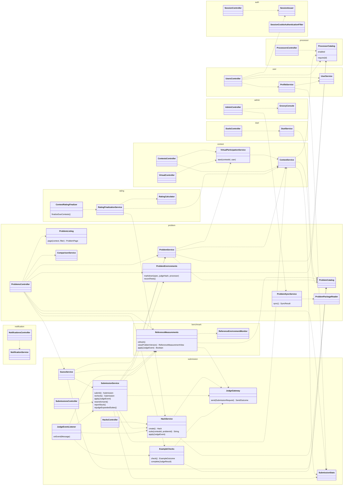
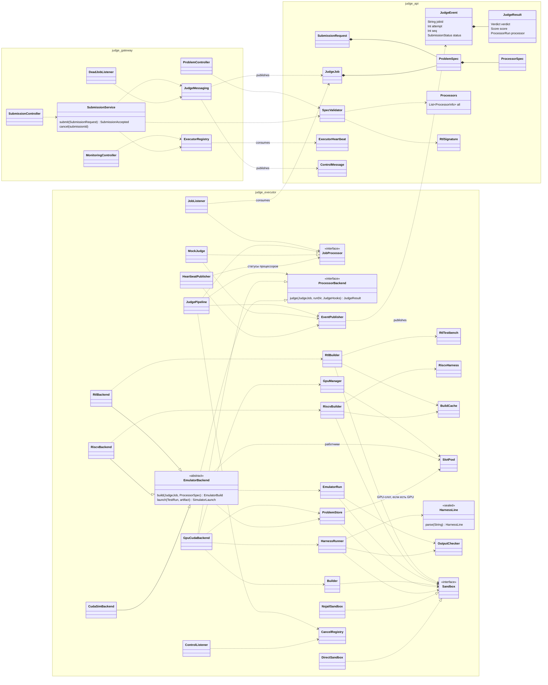

# Архитектура

UML-диаграммы текущего состояния проекта. Подробности — в [README](../README.md),
[docs/backend/submissions.md](backend/submissions.md) и [judge/README.md](../judge/README.md).

## Развёртывание

Сервисы описаны в корневом `compose.yaml`. Без профилей стартует только PostgreSQL; `app` поднимает backend
и frontend, `judge` — RabbitMQ и gateway, `gpu` или `mock` добавляют исполнителя.

Служебные обмены RabbitMQ: `judge.heartbeats` (executor → gateway, мониторинг живых исполнителей),
`judge.control` (отмена посылки), `judge.jobs.dead` (задание упало 5 раз — gateway публикует `INTERNAL_ERROR`).

## Дуэли

Поиск соперника и приглашения хранятся отдельно от начавшейся комнаты. Общая блокировка PostgreSQL
сериализует подбор, принятие и отмену. Уведомления доступны только своему пользователю.

## Путь посылки

Обычные задачи и оптимизация используют путь через judge. Исходный код оптимизации и оба варианта
угадывания заранее проверяются и измеряются отдельными заданиями judge. Ответ угадывания
проверяется по готовому поколению замеров и сохраняет неизменяемый снимок результата.
Начавшаяся дуэль использует тот же контест; оба участника уже зарегистрированы при подборе.
Правила форматов: [backend/formats.md](backend/formats.md).

Подробности восстановления и актуальности: [reference-measurements.md](backend/reference-measurements.md).

## Состояния посылки

`SubmissionStatus` в backend и события судьи, которые его меняют.

## Модель данных

JPA-сущности backend, таблицы схемы `gpucodeforces`.

`contextKey` посылки — где она засчитана: `practice`, ID контеста (официальное участие), `upsolve:<контест>`
или `virtual:<попытка>`; правила — в [backend/participation.md](backend/participation.md).

## Компоненты backend

Контроллеры реализуют интерфейсы, сгенерированные из [docs/frontend/openapi.yaml](frontend/openapi.yaml).
Репозитории Spring Data, фильтры безопасности и мапперы опущены.

Фоновые задачи: синхронизация банка задач с репозиторием раз в минуту (`ProblemSyncService`), повторная
отправка непринятых посылок каждые 15 секунд и поиск зависших раз в минуту (`SubmissionService`), повторная
отправка взломов (`HackService`) и перетестирование принятых решений на тестах успешных взломов
(`SubmissionService.rejudgeExpandedSuites`) каждые 15 секунд, финализация результатов и рейтинга завершившихся
контестов раз в минуту (`ContestRatingFinalizer`, по процессорам: рейтинг каждого процессора свой).

## Компоненты тестирующей системы

`judge-api` — общие контракты gateway, executor и backend, включая каталог процессоров. У `JobProcessor` две
реализации: настоящий конвейер и mock (Spring-профиль `mock`). Конвейер выбирает `ProcessorBackend` по процессору
задания; `GpuCudaBackend` — путь на реальной GPU, `RtlBackend` — схема в Verilator, `RiscvBackend` — RISC-V в QEMU с плагином судьи, `CudaSimBackend` — CUDA в GPGPU-Sim. Эмулируемые процессоры
наследуют `EmulatorBackend`: в нём общий порядок проверки (сборка, тесты задачи, работник из пула) и цикл по тестам
`EmulatorRun`, а процессор задаёт только сборку посылки и запуск одного теста. Сборки эмуляторов хранит общий
`BuildCache` (каталог на ключ, ошибки сборки тоже кэшируются). `HarnessRunner` разбирает статус-строки обвязки
`gpu-cuda` в `HarnessLine` и сам решает, могла ли обвязка написать строку в этот момент. Конфигурация и
утилиты опущены.

